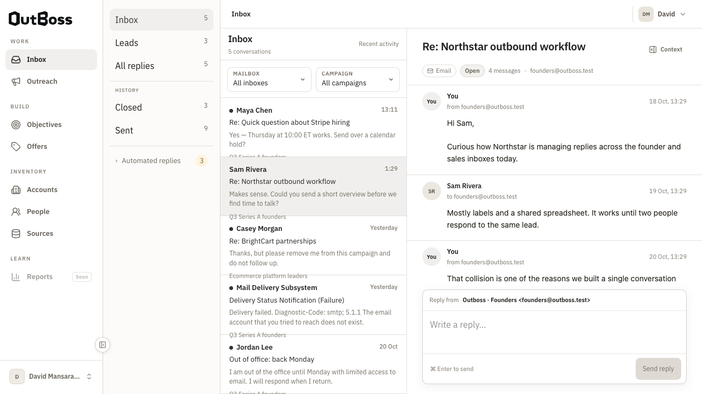

# Outboss

A Laravel and Vue workspace for people, accounts, email campaigns and a unified inbox, with scoped REST/MCP access and governed AI capabilities.

This is a runnable engineering showcase prepared from a committed product snapshot. It includes the application, synthetic fixtures and tests, with a fresh publication history and generic deployment examples.

## What to review

- **Full-stack delivery:** Laravel 13, Vue 3, Inertia, durable people/accounts and multi-step campaigns.
- **Integrations:** Gmail, Microsoft and Zoho adapters, scoped API tokens, REST and MCP surfaces.
- **Reliability:** readiness checks, send pacing, recovery, suppressions and queue-specific worker lifetimes.
- **Governed AI:** provider credentials, budgets, reconciliation and objective/GTM workflows, supported by deterministic tests.

The core campaign workflow is human-written and needs no AI provider. The local demo uses synthetic records and fake mail providers; campaign sending stays off. Real OAuth connections, external AI/research and production delivery require separate configuration and verification.



## Run locally

Requirements: PHP 8.4+, Composer 2, Node 22, npm and SQLite.

```bash
composer install
php scripts/setup-demo.php
php artisan migrate --force
php artisan db:seed --class=UserFlowBrowserSeeder --force
npm ci
npm run build
php artisan serve --host=127.0.0.1 --port=8125 --no-reload
```

Open **http://127.0.0.1:8125** with the synthetic local account **david@outboss.test / password**. The setup helper creates a random application key and an isolated SQLite file without overwriting existing configuration.

## Architecture and evidence

- [Architecture and code map](docs/architecture.md)
- [Local demo and deployment boundary](docs/self-hosting.md)
- [REST API](docs/api.md), [OpenAPI specification](docs/api/openapi.yaml) and [MCP tools](docs/mcp.md)
- [OAuth setup](docs/oauth-setup.md), [export formats](docs/export-formats.md) and [operations](docs/operations.md)
- [Verification results](docs/verification.md) and [snapshot provenance](docs/provenance.md)

## Checks

```bash
php artisan wayfinder:generate --with-form
composer ci:check
npm run build
npx playwright install chromium
npm run test:browser:user-flows
```

The default browser suite uses its own disposable SQLite database on port 8124. CI runs checks and builds; it has no production deployment step.

## Licence

The existing MIT declaration in `composer.json` is preserved. See [provenance](docs/provenance.md).
