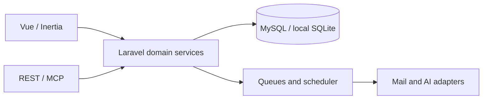

# Architecture

Outboss is a Laravel 13 / Vue 3 application with Inertia, a relational data model, queued domain work, a REST API and MCP tools. This curated snapshot excludes development history, operational evidence, private tooling and production deployment wiring.

| Area | Source | Behaviour worth reviewing |
|---|---|---|
| Campaigns | `app/Domain/Campaigns` | Enrollment, sequencing, pacing, recovery and suppression |
| Mail | `app/Domain/Mail` | Connections, synchronisation, replies and inbox |
| API / MCP | `app/Http/Controllers/Api`, `app/Mcp` | Scoped read, draft, launch and send operations |
| AI | `app/Domain/Ai` | Adapters, credential lifecycle, budgets and reconciliation |
| Objectives / GTM | `app/Domain/Objectives`, `app/Domain/Gtm` | Evidence, approvals, readiness and governed execution |
| UI | `resources/js/pages`, `resources/js/components` | Inbox, contacts and campaign setup |

The base campaign workflow is human-written. AI/GTM code and deterministic tests are included; passing those tests does not establish live provider delivery or external AI performance.

Start with `tests/Feature/Campaigns`, `tests/Feature/Ai`, `tests/Feature/Api/V1`, `tests/Feature/Mcp`, `tests/Feature/Objectives`, `tests/Vue` and `tests/Browser/user-flows`.

Generic release scripts and worker examples remain under `scripts/deploy` and `deploy`. Their paths are examples; no production deployment key or automatic deployment workflow is included.
